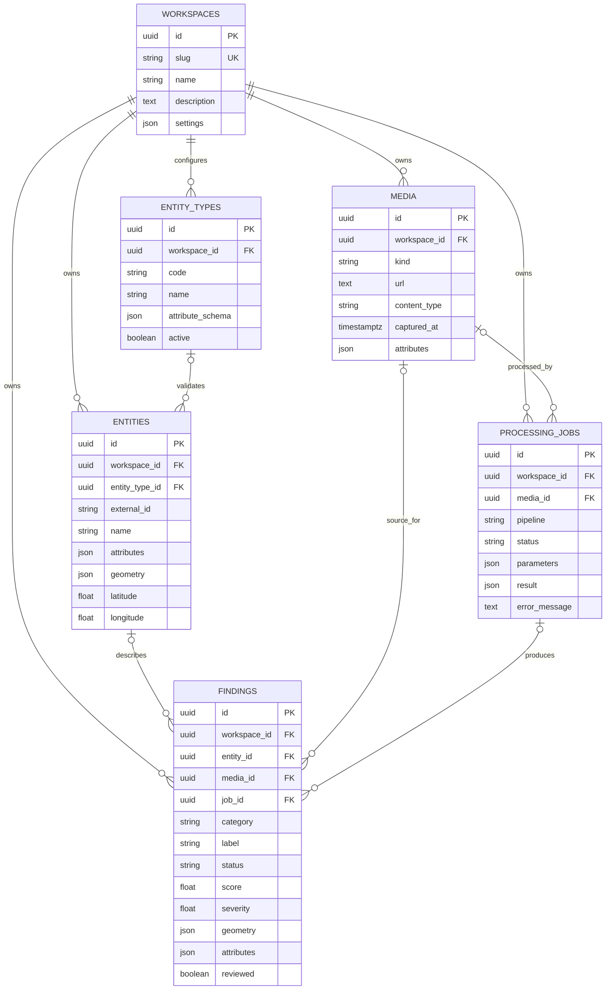

# Схема базы данных

## Связи

## Инварианты

- `workspace.slug` уникален во всей системе.
- `entity_type.code` уникален внутри workspace.
- `entity.external_id` уникален внутри workspace; `NULL` разрешён.
- `finding.score` равен `NULL` или находится в диапазоне от 0 до 1.
- Связанные entity type, entity, media и job должны относиться к тому же workspace. Это проверяет service layer до записи.
- `entity.attributes` проверяется по JSON Schema выбранного `entity_type`.
- Координаты передаются только парой: latitude вместе с longitude.

## Удаление

- Удаление workspace каскадно удаляет принадлежащие ему данные.
- Удаление entity type оставляет entity, но устанавливает `entity_type_id = NULL`.
- Удаление entity, media или job не удаляет finding, а обнуляет соответствующую ссылку. Результат остаётся для аудита.

## Геоданные

Для начальной карты используются индексированные `latitude` и `longitude`. Произвольная точка, bbox, polygon или координаты изображения могут храниться в `geometry`. PostGIS следует добавлять только при подтверждённой необходимости радиусного поиска, пространственных пересечений или маршрутизации.
