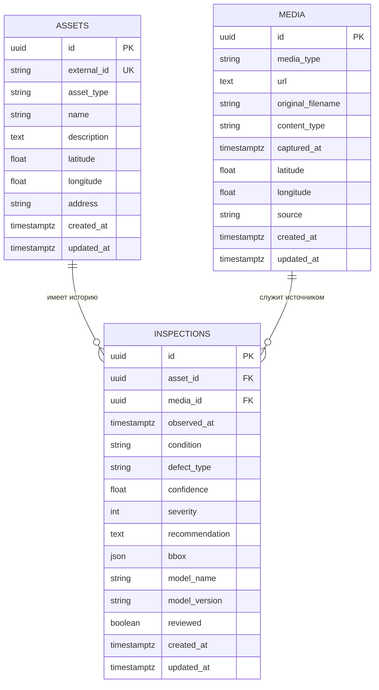

# Схема базы данных

Схема покрывает минимальный цикл: медиафайл поступает в систему, модель находит объект, а результат анализа сохраняется как осмотр.

## Справочные значения

- `asset_type`: `cable_well`, `dual_purpose_support`, `other`.
- `condition`: `normal`, `attention`, `repair`, `critical`.
- `confidence`: уверенность модели от 0 до 1.
- `severity`: оценка опасности от 0 до 100, не вероятность.
- `bbox`: координаты области детекции, например `{"x": 10, "y": 20, "width": 100, "height": 80}`.

PostGIS на старте не нужен: для MVP карта получает объекты по прямоугольнику из `min_lat`, `max_lat`, `min_lon`, `max_lon`. Если появятся поиск по радиусу или маршруты, координаты можно мигрировать в `geography(Point, 4326)`.
